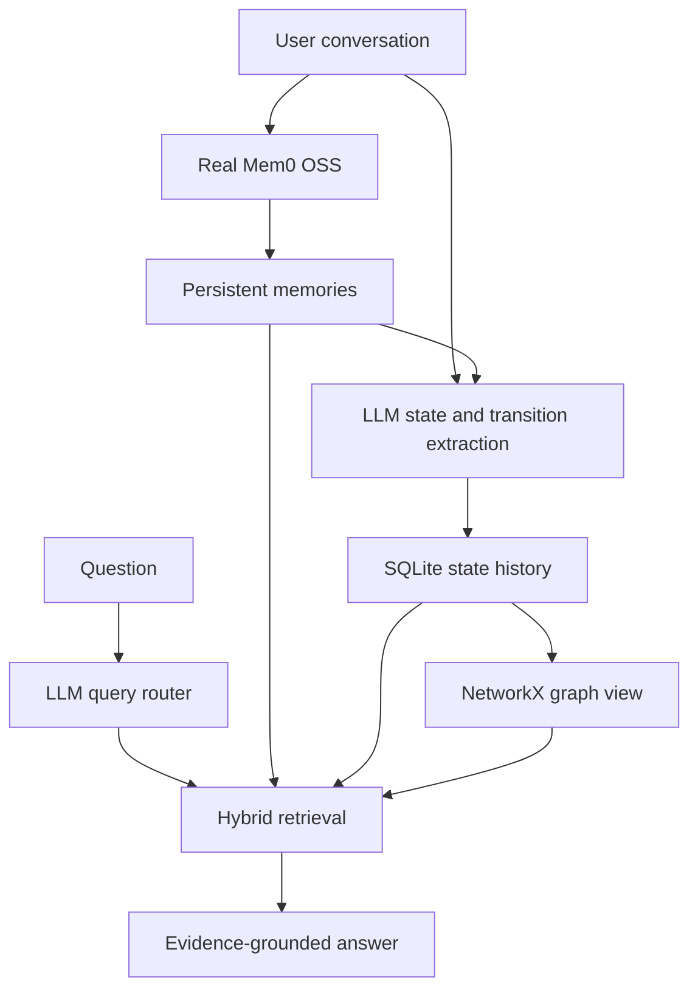

# CausalMem

CausalMem is a real-time, user-driven memory application built on the actual `mem0ai` OSS package (`from mem0 import Memory`). It adds a durable typed state history and evidence-linked transition graph. Mem0 remains the long-term memory engine and semantic retriever. CausalMem's contribution is an explicit representation intended to make state evolution, causal paths, and multi-hop historical reasoning inspectable.

The primary interface is a React + TypeScript console served by FastAPI. The older Streamlit view (`app.py`) is retained as a legacy interface, not the documented entry point.

## Research problem and questions

Personal-memory systems need to retrieve useful facts while representing how a person's goals, preferences, and activities change. A semantic memory store can retrieve conversational records, but researchers and users may also need an inspectable history of which state was valid when and whether a user explicitly gave a reason for a change. CausalMem studies a layered approach: retain Mem0 OSS as the persistent conversational-memory engine and add user-scoped typed state and transition records in SQLite.

The project investigates these questions; they are not claims of proven effectiveness:

1. Can Mem0 be extended with explicit temporal state transitions while preserving prior states for historical retrieval?
2. Can explicitly recorded causes be distinguished from chronological succession without treating sequence as causation?
3. How reliably do retrieval and validation policies support as-of queries and safe abstention on the available synthetic evaluation cases?
4. What performance costs are observed in the current local Ollama configuration, and which pipeline stages account for them?

The intended contribution is an inspectable state-history and evidence-validation layer around Mem0, not a replacement memory store or a claim that causal reasoning is solved.

## Architecture



Mem0 OSS stores and retrieves conversational memories using the configured LLM, embedding provider, and local Qdrant vector store. In the Ollama configuration, `mem0_engine.py` configures the selected Ollama chat model and `nomic-embed-text`; the application keeps provider-specific local Qdrant paths/collections separate. SQLite independently stores typed states and transitions. A message is written to Mem0 first, then passed to state extraction and SQLite ingestion. SQLite state/transition writes have their own transaction, but Mem0 and SQLite do **not** share an atomic transaction; a successful Mem0 write can remain if later extraction or SQLite persistence fails.

The application uses user IDs to scope memory and state namespaces, but these IDs are not authentication. The console's namespace selector is user-selectable, and the HTTP API does not authenticate callers; this project is intended for trusted local use, not an authenticated multi-user service.

## Install and run (Windows PowerShell)

The repository does not declare a formally supported Python-version range.
The project environment inspected for this guide used Python **3.12.10**;
that is the verified reproduction environment here, not a compatibility
guarantee for every Python 3.12 patch release. `requirements.txt` lists
minimum dependency versions, not a lock file. The dependency versions
installed in the inspected environment are listed in
[evaluation/README.md](evaluation/README.md).

```powershell
py -3.12 -m venv .venv
.\.venv\Scripts\Activate.ps1
python -m pip install --upgrade pip
python -m pip install -r requirements.txt
Copy-Item .env.example .env
notepad .env
```

The default sample selects OpenAI, consistent with `config.py`; it needs a
valid `OPENAI_API_KEY`. To use the locally verified Ollama setup instead,
comment out the OpenAI provider/model lines in `.env` and uncomment the
Ollama provider, model, and URL lines. The tested local model tags observed
in this environment were `llama3.2:3b` and `nomic-embed-text:latest`; the
application's Mem0 embedder is configured as `nomic-embed-text` in
`mem0_engine.py`.

Install Ollama using the [official Windows instructions](https://ollama.com/download/windows).
The official PowerShell installer command is:

```powershell
irm https://ollama.com/install.ps1 | iex
```

After installation, start the Ollama Windows app (it normally starts its local
API in the background). If the service is not already running, start it in a
separate terminal with `ollama serve`. In another PowerShell window, obtain
the models configured for this example and verify the installed tags:

```powershell
ollama pull llama3.2:3b
ollama pull nomic-embed-text
ollama list
```

The local API default in `config.py` is `http://localhost:11434`. Keep
`OLLAMA_BASE_URL` in `.env` at that value unless Ollama is deliberately hosted
elsewhere. Do not put credentials in shared logs or reports.

### Run the API and React console

The backend and frontend are separate during development. Use two PowerShell
terminals with the virtual environment activated in each.

Terminal 1, start FastAPI:

```powershell
python api.py
```

The API listens on `http://127.0.0.1:8000`. Its interactive OpenAPI docs are at
`http://127.0.0.1:8000/docs`.

Terminal 2, start the Vite development server:

```powershell
cd web
npm install
npm run dev
```

Open `http://127.0.0.1:5173`. Vite proxies `/api` requests to the FastAPI
server. The frontend was verified with Node `22.20.0` and npm `10.9.3`.

To serve the built console from FastAPI instead of running Vite:

```powershell
cd web
npm run build
cd ..
python api.py
```

Then open `http://127.0.0.1:8000`. FastAPI serves `web/dist` when that build
directory exists and falls back to `index.html` for client-side routes.

The legacy Streamlit view still runs if its dependency is installed, but it is
not the primary interface:

```powershell
python -m streamlit run app.py
```

The app starts with empty Mem0 and SQLite stores. Keep user IDs within a
trusted local environment; distinct IDs are namespaces, not authentication.
The API has no login layer and should not be exposed directly to an untrusted
network.

## Real-time workflow

`chat_service.process_chat` is the shared workflow behind both the HTTP API and the legacy Streamlit view. For a statement, it writes to Mem0, reads back memories, and then calls `state_extractor.ingest_message`; that module extracts candidate states and persists SQLite state/transition changes. These Mem0 and SQLite steps are sequential and are not one cross-store transaction. SQLite's transaction protects its related state, transition, and closure writes. Questions are classified and sent through `hybrid_retriever.retrieve`, which can combine user-scoped Mem0 records with SQLite state and transition evidence. `answer_generator` applies deterministic ownership, temporal, evidence-support, ambiguity, and causal checks to structured model claims. The prompt guides the model, but the prompt alone is not the safety mechanism. When evidence is insufficient, malformed, ambiguous, or a retrieval source fails, the answer path can reject claims or abstain.

The React console displays memories and IDs, structured states, the state/transition timeline, query category, retrieval sources, citation validation, safe diagnostics, and the response evidence bundle. Those displays and the application's console output can contain user content; use only trusted local sessions and protect captured logs. Raw prompts and raw model responses are not returned by the API's diagnostic surfaces.

Temporal intervals use the half-open rule `valid_from <= requested_time < valid_until`; a null end is open-ended. A requested as-of timestamp selects state validity by recorded timestamps. These timestamps mean when CausalMem recorded the state or transition, not necessarily when the real-world event occurred. Natural-date handling is conservative, and unsupported or ambiguous time requests are not intended to silently become current-state queries. Temporal succession supports ordering, not causation. `EXPLICIT_CAUSE` may support a causal claim only when recorded cause evidence and valid same-user endpoints pass the answer gate. State and transition records retain source-memory attribution where available. State confidence is not statistically calibrated.

## Modules

- `mem0_engine.py`: wraps real Mem0 `add`, `search`, `get_all`, `update`, and `delete` operations.
- `llm_service.py`: configurable structured state extraction, query classification, and grounded response generation.
- `database.py`, `models.py`: persistent user-scoped typed records.
- `state_extractor.py`, `temporal_engine.py`, `transition_engine.py`, `causal_graph.py`: temporal history and graph construction.
- `query_router.py`, `hybrid_retriever.py`, `answer_generator.py`: query-adaptive evidence flow.
- `chat_service.py`: UI-independent chat, ingestion, citation parsing, and safe response shaping.
- `api.py`: FastAPI endpoints for chat, memories, states, transitions, timeline, diagnostics, and static console serving.
- `web/`: React + TypeScript + Vite research console (Chat, Memory Explorer, Timeline, Evidence Inspector, Diagnostics, Settings).
- `visualization.py`, `app.py`: legacy Streamlit view and graph rendering.
- `dataset_generator.py`, `benchmark.py`, `evaluator.py`: separate synthetic-data evaluation tools; the live app never loads their data.

## Evaluation and reproduction

The live app does not load the evaluation datasets. The project has deterministic policy tests, oracle-only temporal checks, end-to-end temporal retrieval fixtures, and recorded live-pipeline observations; these have different scopes and must not be combined as one performance score. See [evaluation/README.md](evaluation/README.md) for dataset definitions, metric limitations, recorded results, and the isolated live-evaluation procedure.

For the legacy paired benchmark, use a fresh isolation root and keep output inside it:

```powershell
$run = Join-Path (Get-Location) ('.tmp\benchmark-' + [guid]::NewGuid().ToString('N'))
python .\benchmark.py --isolation-dir "$run" --output-dir "$run\results" --dataset .\evaluation\ground_truth.jsonl --modes mem0 state temporal graph full
```

`mem0` is the Mem0-only baseline; `state`, `temporal`, and `graph` select extension evidence; `full` runs the hybrid path. The CLI refuses reused stores and result files and requires the output paths to remain inside the isolation root. A new run requires local model/provider availability. Result files contain predictions and evidence and should be treated as sensitive. The metrics are prototype proxies, not semantic human judgments; recorded observations and their limits are documented in the evaluation README.

## Limitations and future work

LLM extraction can miss nuance and confidence is not calibrated. Natural-date interpretation is intentionally limited; stored time is recording time rather than parsed event time. Small synthetic evaluations and lexical/fixture-key metrics do not establish semantic correctness or general reliability. The recorded local CPU diagnostic indicates substantial latency, but it does not establish a single root cause. User correction workflows, calibrated confidence, authenticated accounts, and broader independently reviewed evaluations remain open work. The local prototype is not a hosted multi-tenant service.

`docs/CODEBASE_AUDIT.md` and `docs/PHASE_7A_AUDIT.md` are dated point-in-time audits. They preserve historical findings and are not authoritative descriptions of every later implementation change; use the current source and this README for the current high-level description.

## Tests

```powershell
pytest -q
```

The test suite exercises deterministic policy, persistence, retrieval, temporal, causal, isolation, benchmark, and mocked ingestion paths. Those tests do not measure live-model answer quality. Windows environments may need an isolated pytest base directory and disabled cache/tmpdir plugins if pytest's temporary-directory cleanup fails; see the evaluation README for the recorded workaround. A live Mem0/LLM evaluation requires configured local services and a fresh isolation root.
